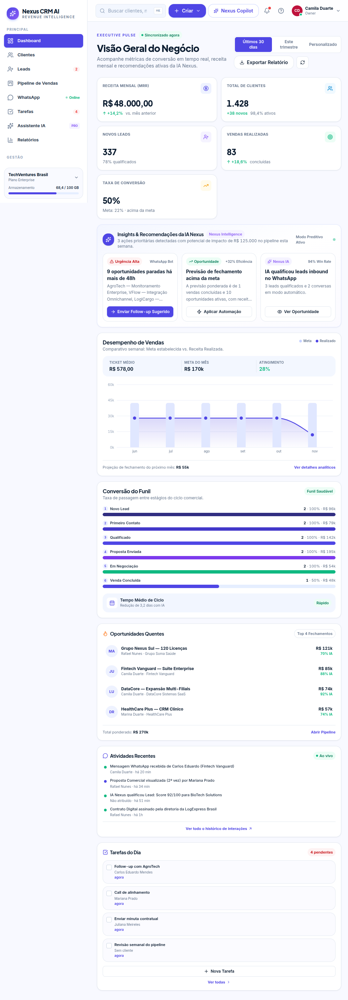
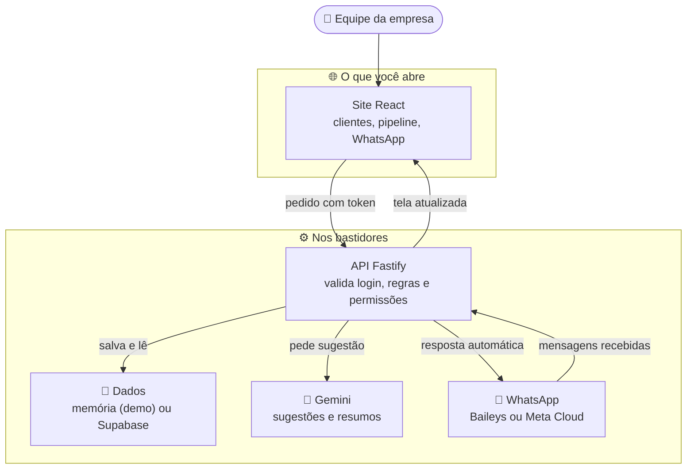

<div align="center">

# Nexus CRM

### Um CRM com WhatsApp e inteligência artificial para cuidar de clientes, leads e vendas — tudo no mesmo lugar.

[](https://www.typescriptlang.org/)
[](https://fastify.dev/)
[](https://react.dev/)
[](https://pnpm.io/)
[](https://tailwindcss.com/)
[](https://supabase.com/)
[](https://www.whatsapp.com/)
[](https://ai.google.dev/)
[](https://vitest.dev/)
[](https://render.com/)
[](https://vercel.com/)

**💬 WhatsApp · 🤖 Agentes de IA · 👥 Multi-empresas · 📊 Pipeline de vendas**



</div>

---

## 📑 Índice

| | |
|---|---|
| [🎯 O que é](#user-content-o-que-e) | [⚙️ API](#user-content-api) |
| [✨ Funcionalidades](#user-content-funcionalidades) | [🌐 Site](#user-content-site) |
| [🧩 Como funciona](#user-content-como-funciona) | [💬 WhatsApp e IA](#user-content-whatsapp-e-ia) |
| [🚀 Como rodar](#user-content-como-rodar) | [🔐 Login e permissões](#user-content-login-e-permissões) |
| [☁️ Deploy](#user-content-deploy) | [🛠️ Tecnologias](#user-content-tecnologias) |

---

<a id="o-que-e"></a>

## 🎯 O que é

Pense no Nexus CRM como **uma mesa de trabalho única para uma empresa atender seus clientes**. Em vez de ter a lista de clientes numa planilha, as conversas no celular, as tarefas no papel e as vendas na cabeça, tudo fica junto — e a IA ainda ajuda a responder e a organizar.

Ele é **multi-tenant**: várias empresas podem usar o mesmo sistema, mas cada uma vê **somente os seus próprios** clientes, conversas e vendas. É como um prédio com vários escritórios — cada um com sua chave.

> 💡 **Em uma frase:** um CRM que recebe mensagens do WhatsApp, sugere respostas com IA e acompanha leads, negócios e tarefas por empresa.

---

<a id="funcionalidades"></a>

## ✨ Funcionalidades

| Recurso | O que faz, em palavras simples |
|---|---|
| 👥 **Clientes e leads** | Cadastro de pessoas, com telefone, etiquetas e responsável. Leads são "possíveis clientes" |
| 💰 **Pipeline de vendas** | Arraste a oportunidade entre 7 etapas: novo lead → primeiro contato → qualificado → proposta → negociação → ganho/perdido |
| ✅ **Tarefas** | Lembretes de ligar, enviar mensagem ou fazer follow-up, com prioridade e prazo |
| 💬 **WhatsApp** | Recebe e envia mensagens, mostra conversas não lidas, permite passar atendimento para outra pessoa |
| 🤖 **Assistente** | Chat que entende pedidos como "resuma essa conversa" ou "crie uma tarefa para amanhã" |
| ⚙️ **Automações** | Cliente novo cria lead; venda ganha cria tarefa; conversas paradas há 48h ganham follow-up |
| 📊 **Relatórios** | Dashboard com gráficos e exportação CSV |
| 👤 **Equipe** | Convite de usuários com papéis: dono, admin, gerente, vendedor ou atendente |

---

<a id="como-funciona"></a>

## 🧩 Como funciona



**Traduzindo:** você abre o site e faz login. O site conversa com a **API**, que confere seu token, identifica de qual empresa você é e só deixa você ver os dados daquela empresa. Quando chega uma mensagem no WhatsApp, a API registra a conversa, pede uma sugestão ao Gemini e — se o modo estiver automático — responde sozinha.

---

<a id="api"></a>

## ⚙️ API

A API é feita em **Fastify** e tem documentação automática: acesse **`/docs`** para ver e testar todos os endpoints (Swagger).

| Grupo | O que faz |
|---|---|
| `/auth` | Login, cadastro, sessão e saída |
| `/customers`, `/leads`, `/deals`, `/tasks` | CRM: clientes, oportunidades e tarefas |
| `/team` | Membros da equipe |
| `/whatsapp`, `/conversations` | Conexão do WhatsApp, conversas e mensagens |
| `/ai` | Chat, resumo, qualificação de lead e sugestões |
| `/reports`, `/activities`, `/automations` | Números, histórico e automações |
| `/health` | "Estou vivo?" — usado pelo Render |

**Regras importantes:**
- 🔐 Token JWT com validade de **7 dias**
- 🏢 Toda consulta filtra pela empresa (`organization_id`)
- 🚫 A IA **nunca envia mensagem** em conversas no modo `manual`
- 🔁 Mensagens repetidas não são duplicadas (idempotência)
- 🚦 Limites de uso: 300 requisições/minuto, 10 login/minuto, 5 cadastros/minuto

---

<a id="site"></a>

## 🌐 Site

O site é uma aplicação React com Vite e Tailwind. As telas principais:

| Tela | Caminho |
|---|---|
| Dashboard | `/dashboard` |
| Clientes e detalhe | `/clientes`, `/clientes/:id` |
| Leads e pipeline | `/leads`, `/pipeline` |
| WhatsApp e assistente | `/whatsapp`, `/assistente` |
| Tarefas, automações e relatórios | `/tarefas`, `/automacoes`, `/relatorios` |
| Equipe e configurações | `/equipa`, `/configuracoes` |
| Login e cadastro | `/login`, `/cadastro` |

O site guarda o token de login no navegador (`localStorage`) e usa **TanStack Query** para manter os dados atualizados sem recarregar a página. Na pasta `design/` existem capturas de todas as telas, inclusive versões mobile e tablet.

---

<a id="whatsapp-e-ia"></a>

## 💬 WhatsApp e IA

### WhatsApp

O sistema suporta três modos, escolhidos pela variável `WHATSAPP_PROVIDER`:

| Modo | Quando usar |
|---|---|
| `disabled` (padrão) | Só quer navegar pelo CRM e ver os dados de demonstração |
| `baileys` | Conexão local ou VPS; lê um QR Code e mantém a sessão criptografada |
| `meta_cloud` | Recomendado no Render Free — usa a API oficial da Meta, sem processo persistente |

Nas conversas você pode escolher como a IA atua: **manual** (só você responde), **copilot** (ela sugere, você envia) ou **automático** (ela responde sozinha).

### Inteligência artificial

A IA entende pedidos em linguagem natural e pode **usar ferramentas** — por exemplo, buscar um cliente, ver negócios, criar tarefa ou enviar mensagem. Cada ferramenta respeita as permissões do usuário e os dados da empresa dele.

Se não houver chave do Gemini configurada, o sistema usa respostas determinísticas de exemplo — ou seja, **o projeto roda mesmo sem IA**.

<details>
<summary>🔍 Detalhe técnico (clique para abrir)</summary>

O agente em `apps/api/src/modules/ai/agent.ts` detecta a intenção por expressões regulares (follow-up, resumo, qualificação, envio, panorama) e chama apenas ferramentas permitidas. O modelo padrão é `gemini-3-flash-preview`, chamado por HTTP direto (sem SDK). Com `NODE_ENV=test`, as chamadas são desligadas para deixar os testes previsíveis.

</details>

---

<a id="login-e-permissões"></a>

## 🔐 Login e permissões

Existem cinco papéis na equipe:

| Papel | Pode fazer |
|---|---|
| 👑 Dono | Tudo |
| 🛠️ Admin | Tudo, exceto configurações avançadas |
| 👔 Gerente | Equipe, tarefas, relatórios e IA |
| 🧑‍💼 Vendedor | Enviar WhatsApp e usar IA |
| 🎧 Atendente | Ler dados comerciais, tarefas e conversas |

No **modo demonstração** (sem Supabase) existem contas de exemplo como `camila@nexus.ai`, `rafael@nexus.ai` e `marina@nexus.ai`. Os dados e senhas ficam em `apps/api/src/shared/store.ts`.

> ⚠️ **Os números do dashboard são de demonstração** — o store em memória soma valores fixos só para deixar os gráficos bonitos. Não são dados reais.

---

<a id="como-rodar"></a>

## 🚀 Como rodar

### Requisitos

| Requisito | Recomendado | Por quê |
|---|---|---|
| Node.js | **22+** | Vite 7 e Baileys pedem versão recente (não há `.nvmrc` no repo) |
| pnpm | **10.33.0** (`corepack enable`) | É o gerenciador do monorepo |
| Conta Gemini (opcional) | chave de API | Habilita as respostas inteligentes |
| Supabase (opcional) | projeto + service role | Guarda os dados de verdade |

### 1. Instalar

```bash
git clone https://github.com/Tyago-santos/nexus-crm.git
cd nexus-crm
corepack enable
pnpm install --frozen-lockfile
```

### 2. Rodar tudo de uma vez

```bash
pnpm dev
```

Sobe a API em **http://localhost:3333** e o site em **http://localhost:5173**. A documentação da API fica em **http://localhost:3333/docs**.

> 💡 Não existe `.env.example` no repositório — e isso é intencional: os valores padrão de `apps/api/src/config/env.ts` já permitem rodar localmente sem criar `.env`. Se quiser configurar, crie `apps/api/.env` manualmente.

### 3. Rodar partes separadas

```bash
pnpm dev:api     # só a API
pnpm dev:web     # só o site
pnpm build       # build do site (a API roda TypeScript direto com tsx)
pnpm typecheck   # checagem de tipos
pnpm test        # testes (21 casos na API e pacotes compartilhados)
```

### Variáveis de ambiente (principais)

| Variável | Para que serve | Padrão |
|---|---|---|
| `PORT` | Porta da API | `3333` |
| `JWT_SECRET` | Assinatura do token | valor de desenvolvimento |
| `WEB_ORIGIN` | Endereços liberados no CORS | `http://localhost:5173` |
| `NODE_ENV` | Ambiente; `test` desliga a IA | `development` |
| `WHATSAPP_PROVIDER` | `disabled`, `baileys` ou `meta_cloud` | `disabled` |
| `WHATSAPP_SESSIONS_DIR` | Pasta da sessão criptografada | `./.sessions` |
| `SESSION_ENCRYPTION_KEY` | Chave AES-256-GCM da sessão | valor de desenvolvimento |
| `WEBHOOK_SECRET` | Segredo do webhook do WhatsApp | valor de desenvolvimento |
| `CRON_SECRET` | Segredo das automações internas | valor de desenvolvimento |
| `GEMINI_API_KEY`, `GEMINI_API_KEY_FALLBACKS` | Chave(s) do Gemini | ausentes (IA determinística) |
| `GEMINI_MODEL` | Modelo usado | `gemini-3-flash-preview` |
| `SUPABASE_URL`, `SUPABASE_SERVICE_ROLE_KEY` | Persistência real | ausentes (modo memória) |
| `VITE_API_URL` (site) | Endereço da API | `/api` (proxy do Vite) |

### Banco de dados (opcional)

Sem variáveis do Supabase, o projeto usa **dados em memória** some quando você desliga o servidor. Para persistir de verdade:

```bash
supabase link --project-ref <seu-projeto>
supabase db push
```

As migrations criam 15 tabelas e políticas de acesso por empresa (`supabase/migrations/`). O `supabase/seed.sql` está vazio de propósito — os dados de exemplo ficam no código.

---

<a id="deploy"></a>

## ☁️ Deploy

| Parte | Onde | Como |
|---|---|---|
| ⚙️ API | Render | `render.yaml` (serviço Node, health check `/health`) |
| 🌐 Site | Render ou Vercel | `render.yaml` / `vercel.json` |
| 💾 Banco | Supabase (PostgreSQL) | migrations via CLI |

---

<a id="tecnologias"></a>

## 🛠️ Tecnologias

| Camada | Stack |
|---|---|
| ⚙️ API | Node.js · Fastify 5 · TypeScript · Zod · Supabase JS · Baileys · Gemini · pino · Vitest |
| 🌐 Site | React 19 · Vite 7 · Tailwind 4 · React Router 7 · TanStack Query · React Hook Form · Recharts |
| 📦 Compartilhado | Schemas Zod, validações, RBAC e tipos gerados do banco |
| ☁️ Infra | Render · Vercel · Supabase |

**Estrutura:**

```text
nexus-crm/
├── apps/api/        API Fastify, módulos, WhatsApp, IA, store em memória
├── apps/web/        Site React (páginas, hooks, componentes)
├── packages/        schemas · shared (regras) · types (banco)
├── supabase/        migrations e RLS
├── design/          capturas das telas (desktop, tablet e mobile)
└── docs/            arquitetura e fluxos
```

---

## 📝 Notas importantes

- 📌 `.env.example` citado em documentos antigos **não existe** — crie o `.env` manualmente se precisar.
- 📌 Dados de demonstração e números do dashboard são **ficção**, vindos do store em memória.
- 📌 Com Supabase configurado, o login usa Supabase Auth e as contas demo não vêm mais do código.
- 📌 `META_WA_APP_SECRET` aparece em docs antigos, mas quem protege o webhook é `WEBHOOK_SECRET`.
- 📌 `pnpm lint` está declarado, mas nenhum pacote define lint de fato.

---

<div align="center">

Feito com 💚 por **Tiago Santos**

[](https://github.com/Tyago-santos)
[](https://www.linkedin.com/in/tiago-santos-b10165376/)

</div>
